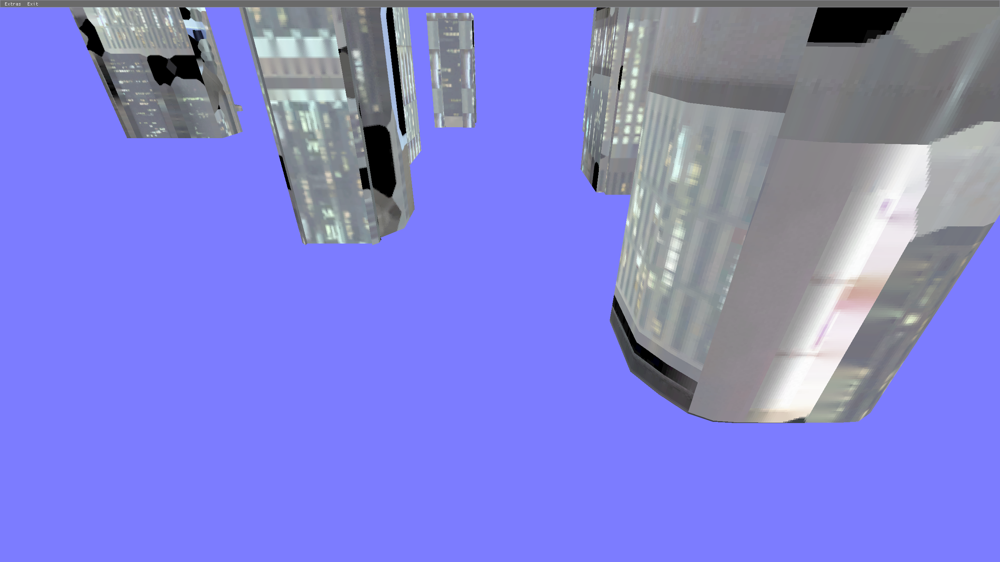
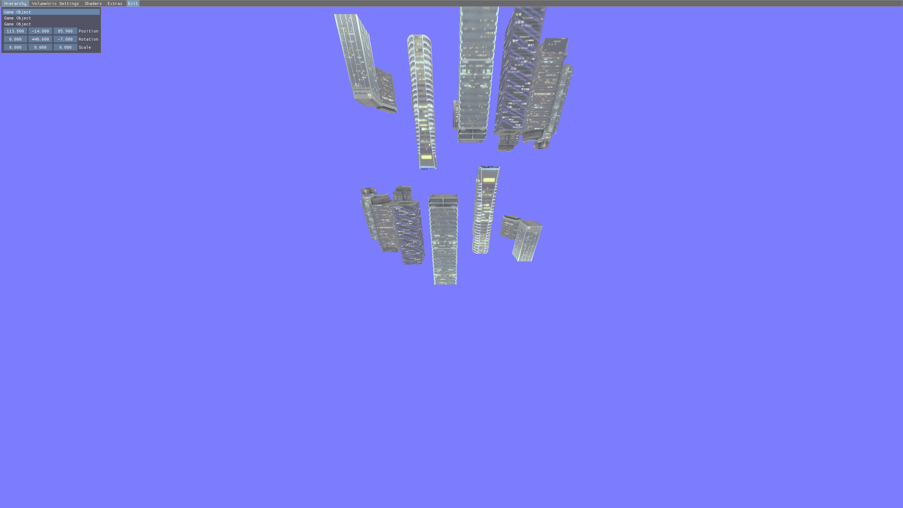

## Introduction
This will be the first development blog of my personal project Hyperion. The goal of these development blogs is to document my thought process when working on the created systems, and challenges encountered along the way. 

<hr class="article-divider">

## Initial Goal Change
Initially the goal of the project was to present a volumetric lighting system at GradEx, which is a showcase of student works my university hosts every year to industry people. However, as I developing in preparation for the showcase, this project felt perfect to upkeep my skills across multiple areas of programming, with graphics and engine being the primary focus. 

<hr class="article-divider">

## Initial Steps
While I already had a project based on volumetric lighting in place, it needed a lot of work to be presentable for GradEx, and to that I restarted the project from scratch. Main reason being there was a lot of conflict while working on the project previously, this was due to using a preexisting framework and building the volumetric lighting system on top when that wasn't the intended purpose of the framework. 

<br>

### Windows Creation and DirectX 11 Setup
To do this task I had around two weeks to build up a framework from scratch and make an entirely new volumetric lighting system. To begin I took this step by step with a window creation using Chris Hecker's guide<sup>[[1]](#CreatingAWindow)</sup> from 2013. Followed by setting up DirectX 11 as the engine's main graphics API due to my experiences with it, and potential for other graphics APIs to be set up down the line. 

Originally, it would be set to just return the DirectX 11 renderer, but later on I added an option to choose which graphics API you want. 
```cpp 
"Application.cpp"
m_renderer = BaseRenderer::CreateRendererObject();
result = m_renderer->Initialise(windowHandle);

"BaseRenderer.cpp"
BaseRenderer* BaseRenderer::CreateRendererObject()
{
    return new DX11Renderer();
}
```
```cpp 
"Application.cpp"
m_renderer = BaseRenderer::CreateRendererObject(BaseRenderer::API::DX11);
result = m_renderer->Initialise(windowHandle);

"BaseRenderer.cpp"
BaseRenderer* BaseRenderer::CreateRendererObject(API api)
{
    if (api == API::DX11)
    {
        return new DX11Renderer();
    }
    else if (api == API::DX12)
    {
        return new DX12Renderer();
    }

    return nullptr;
}
```

<p align="center">
    <a href="InitialPopup.png">  </a>
    <br>
    <em>Figure 1: This was the result of the initial pop up window with DirectX 11 clearing the screen to a blue colour. (Figure is clickable).</em>
</p>

<br>

### ImGui and Object Loader
Following that I set up more basics like ImGui<sup>[[2]](#ImGui)</sup> so I can interact with the application, an object loader<sup>[[3]](#ObjectLoading)</sup> to load in models, and a DDS texture loader<sup>[[4]](#DDSTextureLoader)</sup> so that those models can be textured. While this wasn't difficult to do I noticed problems with the texture not matching correctly to the UV texture. 

<p align="center">
    <a href="ObjectLoading.png">  </a>
    <br>
    <em>Figure 2: Had objects loading, but noticed the textures not matching to the UV texture correctly. (Figure is clickable).</em>
</p>

<br>

### Scene Management
Before moving on, I wanted to improve the current scene management of the project, since currently the application would load the game object through Scene, which handled the ownership of any created game objects. Followed by the Renderer creating a DDS texture and applying it to any object on screen.
```cpp 
"Application.cpp"
m_scene->LoadGameObjectFromOBJ("Assets/cat.obj", m_renderer->GetDevice());

"DX11Renderer.cpp"
hr = DirectX::CreateDDSTextureFromFile(m_d3dDevice, L"Assets\\Textures\\catColour.dds", nullptr, &texture);
LogHR("CreateDDSTextureFromFile(catColour)", hr);

m_immediateContext->PSSetShaderResources(0, 1, &texture);
```
<br>

Instead of doing that, the Scene would still manage the creation and ownership of game objects, while Application would now have access to game objects and the ability to change their properties without owning them, through the raw pointer that was returned. 
```cpp
"Application.cpp"
m_buildings = m_scene->LoadGameObjectFromOBJ("Assets/Buildings.obj", m_renderer->GetDevice());
m_buildings->SetPosition({ 5, -25, 50, 1 });
m_buildings->SetRotation({ 0, 0, 0, 1 });
m_buildings->SetScale({ 2, 2, 2, 1 });
m_buildings->GetTexture().diffuse = m_textureManager->LoadTexture("Assets\\Textures\\buildingDiffuse.dds", m_renderer->GetDevice());

"Scene.cpp"
void Scene::Update(float deltaTime)
{
	for (auto& gameObject : m_gameObjects)
	{
		gameObject->Update(deltaTime);
	}
}
```

<br>

At this stage, I was also able to figure out a fix for the textures not being loaded in correctly. This stems from how different graphic APIs use different texture coordinate origins. By flipping the Y texture coordinates when building the mesh, it fixes that problem.

```cpp
"MeshLoader.cpp"
// Broken for DX11
if (!attrib.texcoords.empty())
{
    v.TexCoord =
    {
        attrib.texcoords[2 * idx.texcoord_index + 0],
        attrib.texcoords[2 * idx.texcoord_index + 1]
    };
}

// Fixed
if (!attrib.texcoords.empty())
{
    v.TexCoord =
    {
        attrib.texcoords[2 * idx.texcoord_index + 0],
        attrib.texcoords[2 * idx.texcoord_index + 1]
    };

    v.TexCoord.y = 1.0f - v.TexCoord.y;
}
```

<p align="center">
    <a href="MultipleObjects.png">  </a>
    <br>
    <em>Figure 3: Multiple objects rendered and fixed the problem with textures. (Figure is clickable).</em>
</p>

<hr class="article-divider">

## What's Next
This went over a good portion of my initial steps in creating this project, with only a minor hiccup that caused some time figuring as to why it wasn't working. My next steps were implementing the volumetric lighting system I previously created while also adding any additional features required to showcase the project in a better light for GradEx.

<hr class="article-divider">

## Assets Used
Buildings - [Link](https://sketchfab.com/3d-models/low-poly-night-city-building-skyline-b0035b8713b048bb8ddf311ee67c28c8)

<hr class="article-divider">

## References
<a id="CreatingAWindow">1.</a> Chris Hecker (2013). Lesson 3: Creating a window. [online] DirectXTutorial.com. Available at: [http://www.directxtutorial.com/Lesson.aspx?lessonid=9-1-3](http://www.directxtutorial.com/Lesson.aspx?lessonid=9-1-3).

<a id="ImGui">2.</a> ocornut (2019). Ocornut/Imgui. [online] GitHub. [online] Available at: [https://github.com/ocornut/imgui](https://github.com/ocornut/imgui).

<a id="ObjectLoading">3.</a> GitHub. (2024). Tinyobjloader/tinyobjloader. [online] Available at: [https://github.com/tinyobjloader/tinyobjloader](https://github.com/tinyobjloader/tinyobjloader).

<a id="DDSTextureLoader">4.</a> Github.com. (2026). Page restricted. [online] Available at: [https://github.com/microsoft/DirectXTK/wiki/DDSTextureLoader](https://github.com/microsoft/DirectXTK/wiki/DDSTextureLoader).

<hr class="article-divider">

<!-- Back And Blog Navigation -->
<section class="article-terminal-navigation split-navigation">
  <div>
    <a href="{{ '/' | relative_url }}" class="project-button">← BACK TO HOME</a>
    <a href="{{ '/blogs/' | relative_url }}" class="project-button">← BACK TO BLOGS</a>
  </div>
  <div>
    <a href="{{ '/blogs/Hyperion/2026-11-27-VolumetricLighting/index.html' | relative_url }}" class="project-button">BLOG #2 →</a>
  </div>
</section>