## Introduction
In this second development blog for Hyperion, I will be adding more necessary features while also implementing different versions of volumetric lighting until the best looking came out, and the challenges faced along the way. 

<hr class="article-divider">

## Volumetric Scattering
Looked back on some key research from Nvidia<sup>[[1]](#VolumetricScattering)</sup><sup>[[2]](#VolumetricLighting)</sup> to get their set of equations for volumetric scattering on the new engine, and while it didn't cause any problem with the actual program there was an unsatisfactory visual result. 
```cpp
"PostScatteringShader.hlsl"
//--------------------------------------------------------------------------------------
// Pixel Shader
//--------------------------------------------------------------------------------------
float4 PS_PostVolumetric(PS_Input input) : SV_Target
{
  // Calculate vector from pixel to light source in screen space.
  float2 deltaTexCoord = (input.TexCoord - LightPosition.xy);
  
  // Divide by number of samples and scale by control factor.
  deltaTexCoord *= 1.0f / Samples * Density;
  
  // Store initial sample.
  float3 color = occlusionTex.Sample(bilinearSampler, input.TexCoord.xy);
  
  // Set up illumination decay factor.
  float illuminationDecay = 1.0f;
  
  // Evaluate summation from Equation 3 NUM_SAMPLES iterations.
  for (int i = 0; i < Samples; i++)
  {   
    // Step sample location along ray.
    input.TexCoord -= deltaTexCoord;
      
    // Retrieve sample at new location.
    float3 sample = occlusionTex.Sample(bilinearSampler, input.TexCoord.xy);
      
    // Accumulate combined color.
    color += sample * illuminationDecay;
      
    // Update exponential decay factor.
    illuminationDecay *= Decay;
      
    if (illuminationDecay < 0.01f)
      break;
  }
  
  // Output final color with a further scale control factor.
  color *= LightColour * Exposure;

  return float4(color, 1.0f);
}
```

<br>

At that moment what passes were in place. 
+ Scene Pass - Just a normal shader passes from vertex shader to pixel shader. 
+ Occlusion Pass - Uses the scene geometry as the guideline where to block the light. 
+ Volumetric Scattering Pass - Uses the occlusion render to texture for retrieving the sample in the pixel shader. 
+ Blend Pass - Combines scene and volumetric pass. 

<br>

<p align="center" width="100%">
    <a href="VolumetricScattering.gif">  </a>
    <br>
    <em>Figure 1: Showcases what the result was from using that set of equations. (Figure is clickable).</em>
</p>

<br>

Before moving on to different variations of the Nvidia equations, I wanted to implement a debug viewer of what each shader outputted as a texture on runtime, and while I could use something like RenderDoc to capture individual frames, it wouldn't be the same as seeing the result live.  
<table align="center" width="100%">
  <tr>
    <td align="center" valign="middle" style="width: 50%; padding: 5px;">
      <a href="SceneView.gif">
        
      </a>
    </td>
    <td align="center" valign="middle" style="width: 50%; padding: 5px;">
      <a href="OcclusionView.gif">
        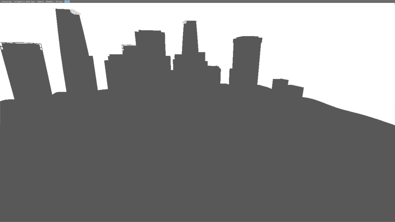
      </a>
    </td>
  </tr>
  <tr>
    <td align="center" valign="middle" style="width: 50%; padding: 5px;">
      <a href="VolumetricView.gif">
        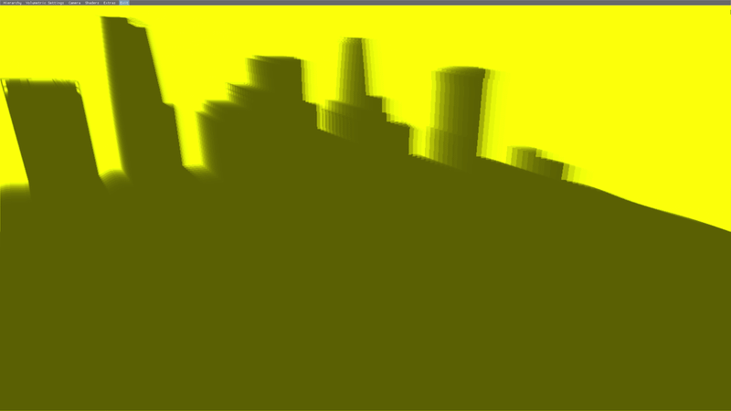
      </a>
    </td>
    <td align="center" valign="middle" style="width: 50%; padding: 5px;">
      <a href="FinalView.gif">
        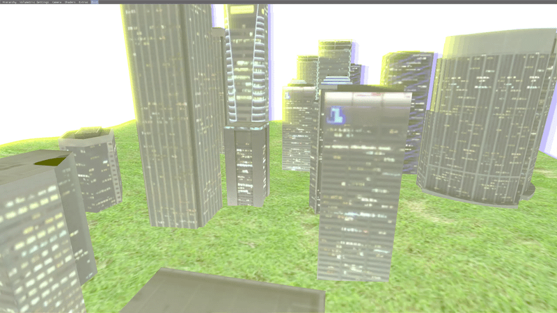
      </a>
    </td>
  </tr>
  <tr>
    <td colspan="2" align="center" style="padding-top: 10px;">
      <em>Figure 2: This showcased the debug viewer in action through the scene texture, occlusion texture, volumetric scattering texture and the final blend, which would be the only one normally seen.  (Figures are clickable).</em>
    </td>
  </tr>
</table>

<br>

While working on the next two iterations of volumetric lighting system, I added a depth and shadow debug view since one or the other used it for their shaders, and in terms of the attempts it again just didn't look right. There were some areas I liked, but once I was done with it, I had the idea to contain the effect to a certain area or in other words volume bound volumetric lighting. A nice benefit of this would be the ability to look at it from an outer perspective for a more cinematic scene. 
<table align="center" width="100%">
  <tr>
    <td align="center" valign="middle" style="width: 50%; padding: 5px;">
      <a href="DepthView.gif">
        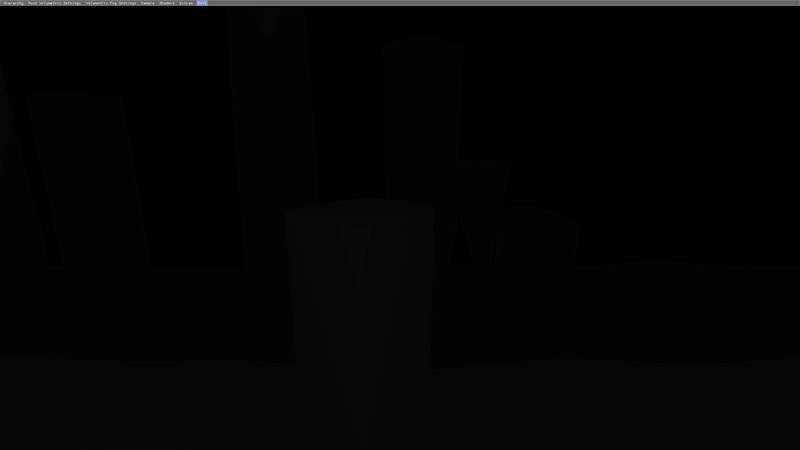
      </a>
    </td>
    <td align="center" valign="middle" style="width: 50%; padding: 5px;">
      <a href="ShadowView.gif">
        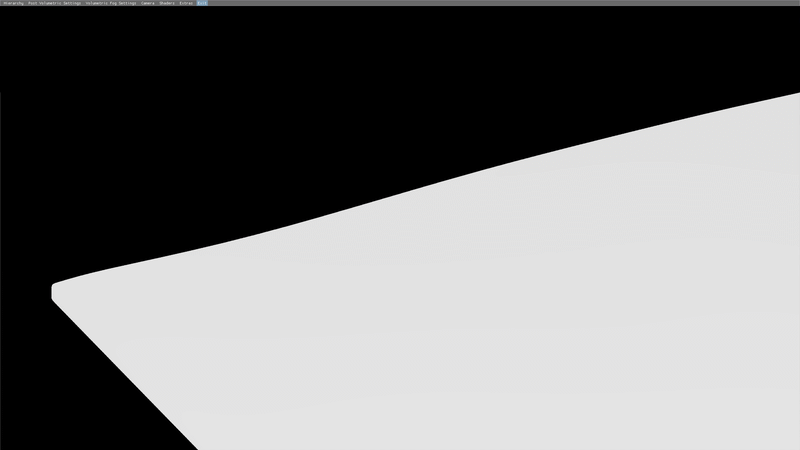
      </a>
    </td>
  </tr>
  <tr>
    <td align="center" valign="middle" style="width: 50%; padding: 5px;">
      <a href="RayMarch.gif">
        
      </a>
    </td>
    <td align="center" valign="middle" style="width: 50%; padding: 5px;">
      <a href="FogMarch.gif">
        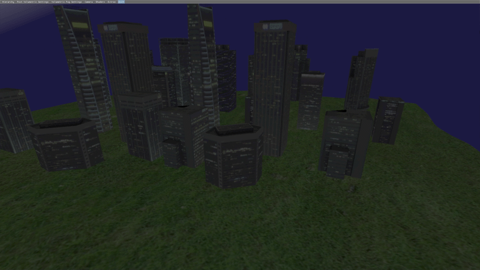
      </a>
    </td>
  </tr>
  <tr>
    <td colspan="2" align="center" style="padding-top: 10px;">
      <em>Figure 3: This showcased the new added depth texture, shadow texture, ray march approach and fog approach. (Figures are clickable).</em>
    </td>
  </tr>
</table>

<br>

## Volume Bound Volumetric Lighting
This was the result and what felt the closest to what I wanted. Anything beyond this point would be to improve how it looks visually and how it might impact performance. Below I go a bit over the most important steps for it.   
<p align="center">
    <a href="VolumeBound.gif"> 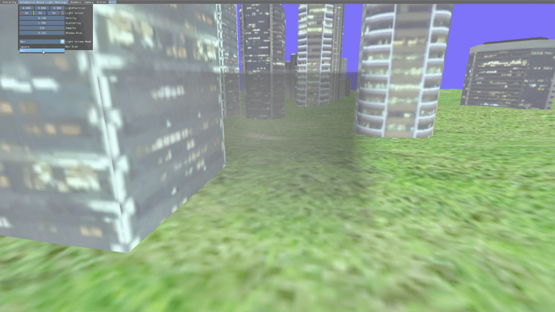 </a>
    <br>
    <em>Figure 4: This showcased the result of making it bound to a specific area through a box or sphere volume. (Figure is clickable).</em>
</p>

<br>

### Camera Ray Reconstruction
The first step was to reconstruct the world space ray for each pixel, this came from converting the scene space texture coordinates into normalised device coordinates (NDC), before using the inverse projection and inverse view matrices to calculate the ray direction.
```cpp
"VolumetricLight.hlsl"
// Create a world space ray from the camera
float2 ndc;
ndc.x = input.TexCoord.x * 2.0f - 1.0f;
ndc.y = 1.0f - input.TexCoord.y * 2.0f;

float4 clipSpace = float4(ndc, 1.0f, 1.0f);

float4 viewSpace = mul(clipSpace, invProjection);
viewSpace.xyz /= viewSpace.w;

float3 rayDir = normalize(mul(float4(viewSpace.xyz, 0.0f), invView).xyz);
```

<br>

This gave each pixel the direction from the camera into the scene, which then can be used to calculate where the ray travels through the volume later. 

<br>

### Volume Intersection
Now that the camera ray was reconstructed, I needed to determine where it would enter and exit through the volume. This was handled through the ray volume intersect function, which returned the distances of where it entered and exited along the ray. By using the scene depth to check how far visible geometry is from the camera I was also able to prevent the volumetric effect going through solid geometry, which was a problem I encountered initially. 
```cpp
"VolumetricLight.hlsl"
// Create a world space ray from the camera
// Intersects the camera ray against volume for volumetric lighting
float rayEnter, rayExit;

if (!RayVolumeIntersect(CameraPos.xyz, rayDir, rayEnter, rayExit))
  return float4(scene, 1);

rayEnter = max(rayEnter, 0.0);
  
float tScene = max(dot(worldDepth - CameraPos.xyz, rayDir), 0.0f);
    
rayExit = min(rayExit, tScene);

if (rayEnter >= rayExit)
  return float4(scene, 1);
```

<table align="center" width="100%">
  <tr>
    <td align="center" valign="middle" style="width: 50%; padding: 5px;">
      <a href="IntersectVisualV.png">
        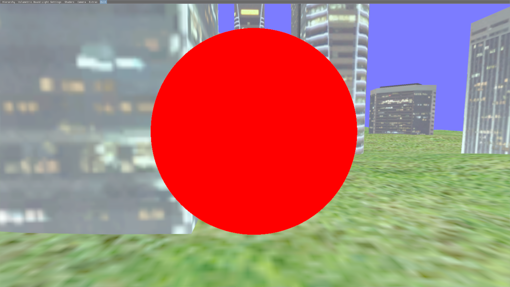
      </a>
    </td>
    <td align="center" valign="middle" style="width: 50%; padding: 5px;">
      <a href="IntersectVisualB.png">
        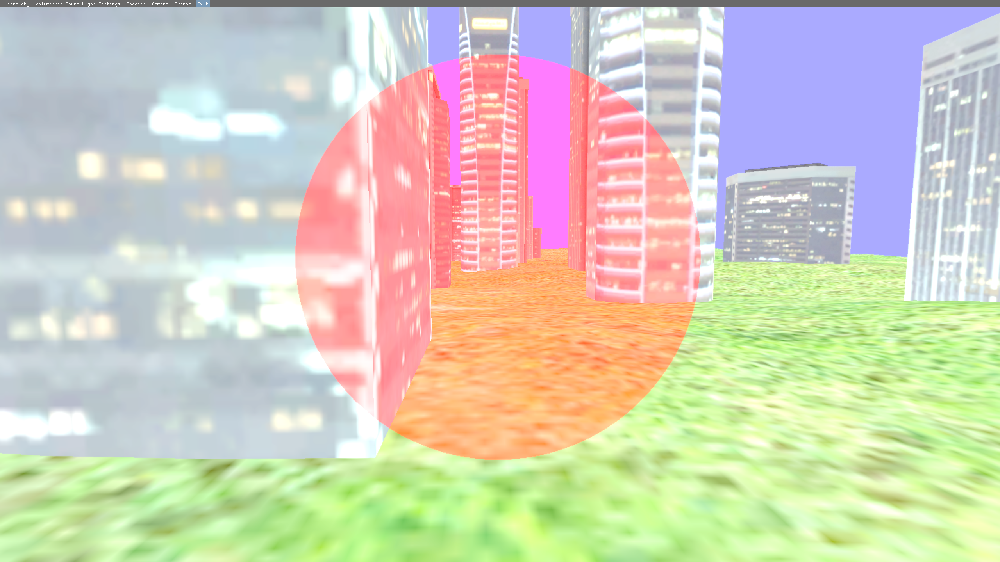
      </a>
    </td>
  </tr>
    <td colspan="2" align="center" style="padding-top: 10px;">
      <em>Figure 5: This shows the visualisation of where the ray intersects with the volume, with red being the indication colour in this scenario. The left side is through the volumetric debug view, while the right side is the final blend. (Figures are clickable).</em>
    </td>
</table>

<br>

### Ray Marching Through The Volume
Now that the other steps were done, I could start sampling the volume with segments created from each entry and exit point, divided by the sample counts to create the positions along the ray. The more would result in more segments making a smoother area and more intensive due to requiring more calculations to be done for each segment. 

<br>

Using each sample to represent a position along the ray as it travels through the volume, and by dividing the distance between the entry and exit points, I could evenly distribute these samples throughout the volume. Adding jitter to the positions was to make the result less consistent.  
```cpp
"VolumetricLight.hlsl"
float segment = (rayExit - rayEnter) / Samples;

[loop]
for (int i = 0; i < Samples; i++)
{
  float jitter = frac(sin(dot(input.TexCoord, float2(12.9898, 78.233))) * 43758.5453);
  float t = rayEnter + (i + 0.5f + jitter * 0.5f) * segment;

  // Current position
  float3 pos = CameraPos.xyz + rayDir * t;

  ---
}
```

<table align="center" width="100%">
  <tr>
    <td align="center" valign="middle" style="width: 50%; padding: 5px;">
      <a href="RayMarchV.png">
        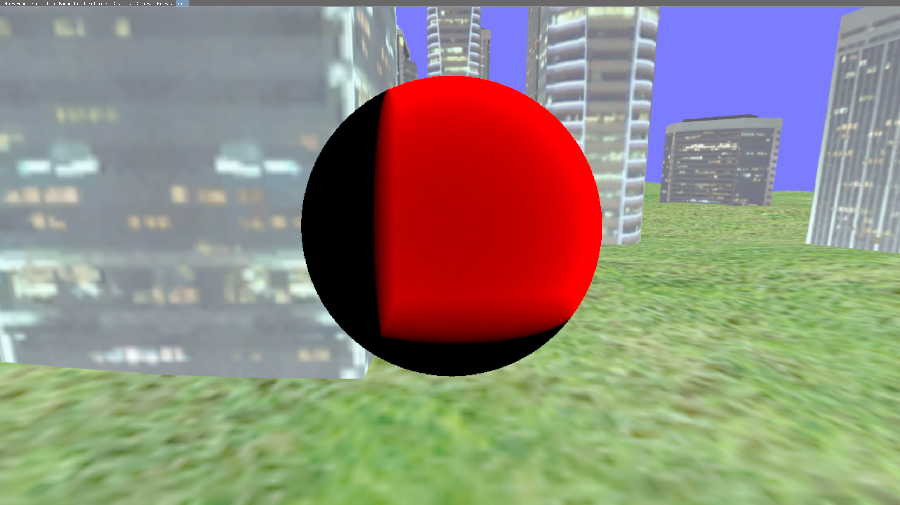
      </a>
    </td>
    <td align="center" valign="middle" style="width: 50%; padding: 5px;">
      <a href="RayMarchB.png">
        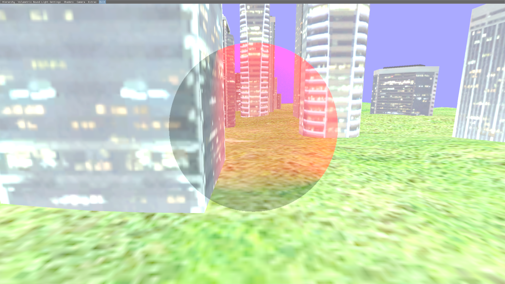
      </a>
    </td>
  </tr>
    <td colspan="2" align="center" style="padding-top: 10px;">
      <em>Figure 6: This shows the visualisation of the ray marching within the volume, with red being where the ray intersects and samples the volume, while black is the areas outside of it. The left side is through the volumetric debug view, while the right side is the final blend. (Figures are clickable).</em>
    </td>
</table>

<br>

### Light Scattering And Density
After that I could calculate how much light was contributed to each sample through several factor like light colour, the scattering strength, density, and shadow test. This was done to create a more visually appealing result with noise<sup>[[3]](#NoiseHash)</sup> as an example helping with getting rid of the consistencies.
```cpp
"VolumetricLight.hlsl"
float shadow = ShadowTest(pos);
 
float phase = saturate(dot(normalize(LightPosition - pos), rayDir));
 
float noise = hash31(pos * 0.5f + float3(Time * 0.2, 0, 0));

float density = Density * noise;

float3 scattering = LightColour.rgb * phase * Scattering * density * shadow;
```

<table align="center" width="100%">
  <tr>
    <td align="center" valign="middle" style="width: 50%; padding: 5px;">
      <a href="DensityV.png">
        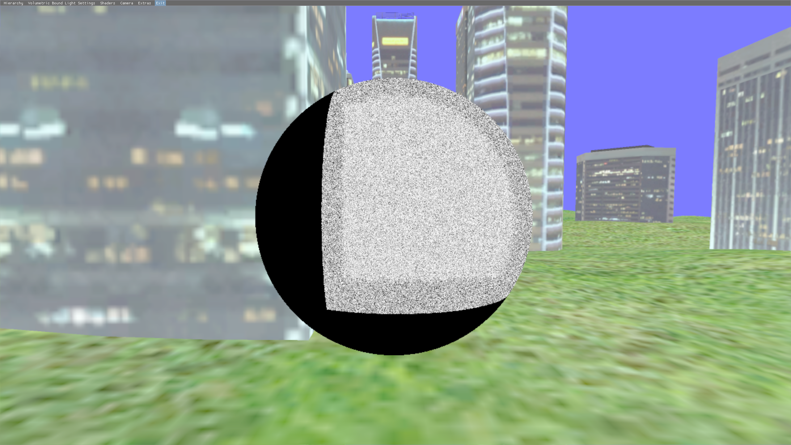
      </a>
    </td>
    <td align="center" valign="middle" style="width: 50%; padding: 5px;">
      <a href="DensityB.png">
        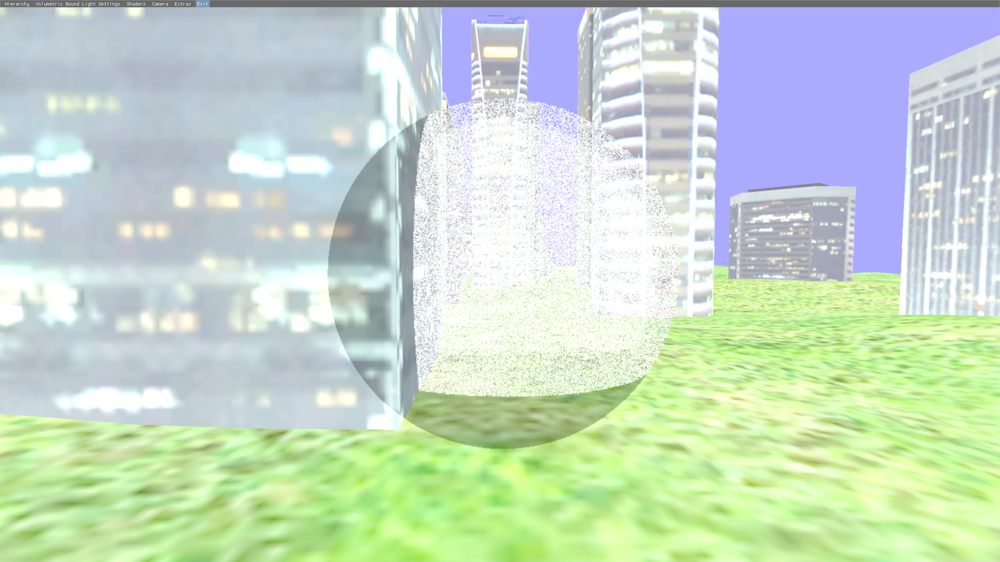
      </a>
    </td>
  </tr>
    <td colspan="2" align="center" style="padding-top: 10px;">
      <em>Figure 7: This shows the visualisation of the calculated density. The left side is through the volumetric debug view, while the right side is the final blend. (Figures are clickable).</em>
    </td>
</table>

<br>

### Light Accumulation
Finally, the individual samples are combined to produce the final volumetric effect. This comes from the accumulated scattered lights along the ray, while keeping track of the remaining transmittance. 
```cpp
"VolumetricLight.hlsl"

 // March through the participating media
float3 fog = 0;
float transmittance = 1;

float segment = (rayEnter - rayExit) / Samples;

[loop]
for (int i = 0; i < Samples; i++)
{
  ...

  // Accumulate light
  fog += transmittance * scattering * segment;
        
  // Beer-Lambert 
  transmittance *= exp(-density * segment);

  if (transmittance < 0.01f)
    break;
}
```
The purpose of the transmittance was controlling how much light passed through the volume. This meant that as it travelled further through there would be less light passing through. This helps to create a more natural accumulation of light rather than having every sample contribute equally. 

<br>

Once all sample were done the accumulated scattering is combined scattering is combined with the original scene colour to produce the final volumetric light result. 
```cpp
"VolumetricLight.hlsl"
// Adds the final accumulated in scattered light
return float4(scene * transmittance + fog, 1);
```

###### Note: A lot of the code was done very quickly and then changed when I had the chance from the naming sense and comments for easier readability.

<hr class="article-divider">

## Extras
Some extra bits that I can mention were adding an FPS counter, and a camera. The purpose of the FPS counter was to see how performance was impacted while using volumetric lighting and while it would stick around a certain threshold it wouldn't be the most accurate test. For this I plan to have a proper performance tester implemented down the line. 

<p align="center">
    <a href="FPSCounter.gif"> 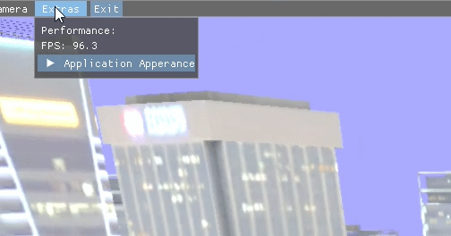 </a>
    <br>
    <em>Figure 8: Showcases the FPS counter in action while rotating around the map. (Figure is clickable).</em>
</p>

<br>

As for the camera the whole purpose was so that I could move around the scene instead of being stuck to one point on runtime, and then upon pressing a button the camera moves along the spline I created. 

<hr class="article-divider">

## What's Next
This was the rundown of how I created the initial volumetric system, and some of the challenges encountered along the way. Next will be improvements I did for this system right before GradEx and more. 

<hr class="article-divider">

## Assets Used
Buildings - [Link](https://sketchfab.com/3d-models/low-poly-night-city-building-skyline-b0035b8713b048bb8ddf311ee67c28c8)

###### Note: Some assets might not be available anymore.

<hr class="article-divider">

## References
<a id="VolumetricScattering">1.</a> NVIDIA Developer. (n.d.). Chapter 13. volumetric light scattering as a post-process. [online] Available at: [https://developer.nvidia.com/gpugems/gpugems3/part-ii-light-and-shadows/chapter-13-volumetric-light-scattering-post-process](https://developer.nvidia.com/gpugems/gpugems3/part-ii-light-and-shadows/chapter-13-volumetric-light-scattering-post-process).

<a id="VolumetricLighting">2.</a> NVIDIA Developer. (2025). NVIDIA volumetric lighting. [online] Available at: [https://developer.nvidia.com/volumetriclighting](https://developer.nvidia.com/volumetriclighting).

<a id="NoiseHash">3.</a> davidar (2022). Hash.Wgsl. [online] Gist. Available at: [https://gist.github.com/davidar/5f9677a0ccfbd63d7a8657ad9af3a856](https://gist.github.com/davidar/5f9677a0ccfbd63d7a8657ad9af3a856).

<hr class="article-divider">

<!-- Back And Blog Navigation -->
<section class="article-terminal-navigation split-navigation">
  <div>
    <a href="{{ '/' | relative_url }}" class="project-button">← BACK TO HOME</a>
    <a href="{{ '/blogs/' | relative_url }}" class="project-button">← BACK TO BLOGS</a>
  </div>
  <div>
    <a href="{{ '/blogs/Hyperion/2026-11-19-InitialStart/index.html' | relative_url }}" class="project-button">← BLOG #1</a>
    <a href="" class="project-button">BLOG #3 (WIP) →</a>
  </div>
</section>
